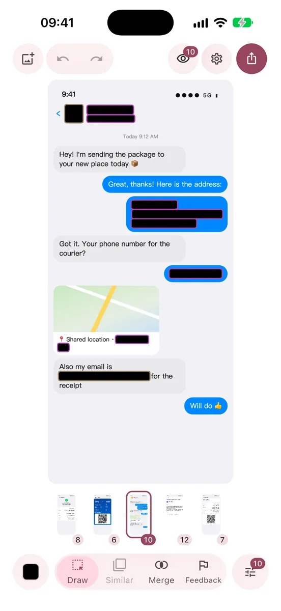
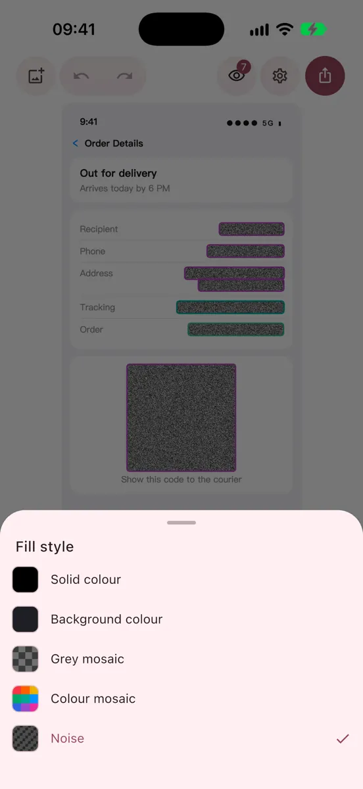
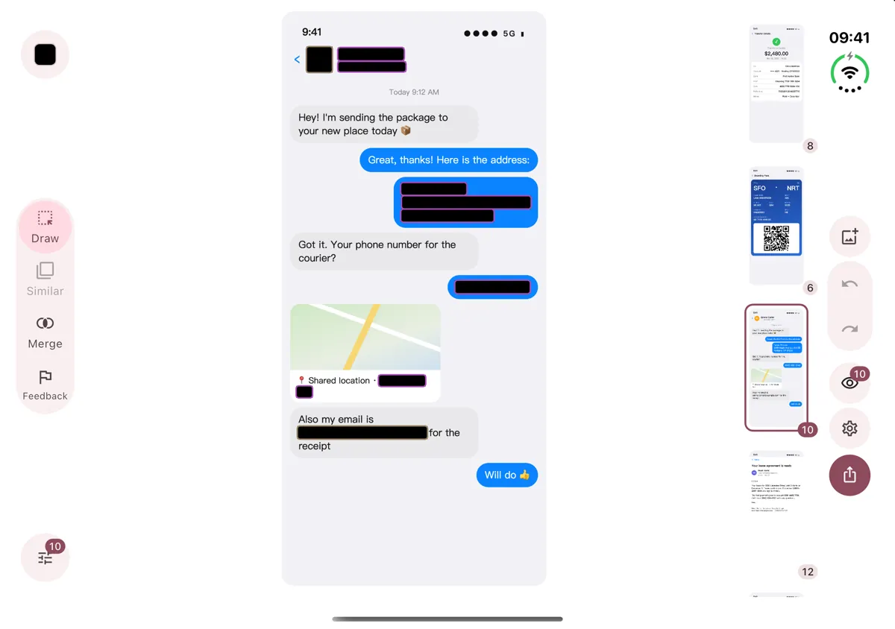

English | [简体中文](README_zh.md)

<div align="center">
  
  <h1>MosaicIt (码住)</h1>
  <p>On-device privacy redaction for screenshots and photos — without OCR, network code, or photo-library read permissions.</p>
  <p>
    <a href="https://mosaic.lollipopkit.com">Website</a> ·
    <a href="https://mosaic.lollipopkit.com/docs">Docs</a> ·
    <a href="https://github.com/lollipopkit/mosaic_it/releases">Releases</a> ·
    <a href="https://mosaic.lollipopkit.com/feedback">Detection Feedback</a> ·
    <a href="LICENSE">AGPL-3.0</a>
  </p>
</div>

<p align="center">
  
  
  
</p>

## Overview

MosaicIt detects private information directly in screenshots and photos on device — using a compact neural vision detector accelerated on Apple Neural Engine (ANE / NPU via CoreML) and Android mobile GPU (LiteRT) for millisecond, low-power inference, without OCR or traditional dictionary/regex matching — and lets you inspect, adjust, and redact regions before exporting.

The app ships with bundled `unseen-det 0.6.0` weights and contains no networking code or network permissions. Images never leave your device.

## Download

| Platform | Artifact | Notes |
| --- | --- | --- |
| Android (`arm64-v8a`) | `MosaicIt_vX.Y.Z_arm64.apk` | Signed release APK, bundled FP16 LiteRT model (`.tflite`), zero `android.permission.*` permissions |
| macOS (Apple Silicon) | `MosaicIt_vX.Y.Z_NoSign_arm64.dmg` | Unsigned ad-hoc app (`arm64`), bundled FP16 ONNX model (`.onnx`); allow in Gatekeeper on first launch |
| iOS (`arm64`) | `MosaicIt_vX.Y.Z_NoSign.ipa` | Unsigned IPA, bundled FP16 ONNX model (`.onnx`); sign and sideload yourself |
| Linux (`amd64`) | `MosaicIt_vX.Y.Z_linux_amd64.tar.gz` | Portable desktop app bundle (`mosaicit`), bundled FP16 ONNX model (`.onnx`) |
| Windows (`amd64`) | `MosaicIt_vX.Y.Z_windows_amd64.zip` | Portable desktop app bundle (`MosaicIt.exe`), bundled FP16 ONNX model (`.onnx`) |
| CLI (`unseen`) | `unseen_vX.Y.Z_{linux_amd64,macos_arm64}.tar.gz`, `unseen_vX.Y.Z_windows_amd64.zip` | Prebuilt Rust CLI binaries (macOS build enables CoreML) |

Every GitHub Release includes `BLAKE3SUMS` and `SHA256SUMS` for verification. Download packages only from [GitHub Releases](https://github.com/lollipopkit/mosaic_it/releases) or build from source.

## Features

**Fast, Low-Power ANE / GPU Neural Detection**

- Bundled compact FP16 `unseen-det 0.6.0` runs on **Apple Neural Engine (ANE / NPU via CoreML)** on macOS and iOS, on **mobile GPU (with XNNPACK CPU fallback via LiteRT)** on Android, and on **ONNX Runtime** on Linux and Windows — delivering millisecond, battery-friendly inference.
- Detects **18 PII classes** across UI screenshots directly from pixels — without OCR or traditional dictionary/regex keyword matching — paired with YuNet for **face** detection (19 classes total):
  `person_name`, `address`, `phone`, `email`, `id_number`, `bank_card`, `plate`, `account_id`, `avatar`, `qr`, `barcode`, `finance`, `organization`, `device_id`, `secret`, `person`, `health`, `personal_info`, `face`.
- Local adaptive threshold preference learns from your keep/uncheck choices on device; custom `.onnx` / `.tflite` models can also be imported in Settings.

**Non-Reversible Redaction Styles**

- Five pixel-overwriting styles: **Solid**, **Surround**, **Blocks**, **Tinted**, and **Noise**.
- None reads pixels inside the redacted rectangle — immune to de-pixelation or de-blurring attacks. `Solid`, `Blocks`, and `Noise` ignore source pixels entirely; `Surround` and `Tinted` sample only a 4 px ring outside the box.

**Direct-to-Editor Workflow**

- Opens directly into the floating editor with native zero-permission media pickers (`PHPickerViewController` on iOS, system Photo Picker on Android, native file dialogs on macOS, Linux, and Windows).
- Hold the eye badge in the top bar to peek at the unredacted original; tap boxes to toggle, draw manual boxes, merge multi-line boxes, or run **Find similar** across a batch of screenshots.
- Native one-tap clipboard copy, system Share sheet, write-only Save to Photos, plus incoming OS Share, Open With, and macOS window drag-and-drop.
- **Export self-check** re-runs the detector and checks pixel correlation on the redacted output before saving or sharing.

**Standalone Rust CLI (`unseen`)**

- Shares `unseen-core` with the Flutter app for scripted detection, batch redaction, benchmarking, calibration, and BLAKE3 model verification.

> Video redaction is currently disabled in the app UI until native video model I/O is supported.

## Privacy & Security Boundaries

Privacy guarantees are enforced at the build, OS permission, and CI level:

| Boundary | Enforcement |
| --- | --- |
| Zero networking in the app | No HTTP client, analytics SDK, or crash reporter; `ci.yml` verifies `pubspec.yaml` and Dart sources contain zero network dependencies or socket APIs. |
| Zero Android release permissions | `release/AndroidManifest.xml` strips transitive permissions; both `ci.yml` and `release.yml` (`aapt2 dump permissions`) verify the release APK declares zero `android.permission.*`. |
| Zero photo-library read access | iOS uses out-of-process `PHPickerViewController` (no `NSPhotoLibraryUsageDescription`) and write-only `.addOnly` saves; Android uses the system Photo Picker. |
| macOS sandbox without network | `Release.entitlements` enables `app-sandbox` and user-selected file read/write only — no `com.apple.security.network.*` entitlement (checked in CI). |
| Optional web feedback | Reporting missed/false-positive detections opens [`mosaic.lollipopkit.com/feedback`](https://mosaic.lollipopkit.com/feedback) in your system browser via a URL `#fragment` that never hits HTTP GET logs and is stripped immediately via `history.replaceState`. |

## Project Structure

```text
.
├── app/                      # Flutter app (iOS, macOS, Android, Linux, Windows) + native-assets FFI hook
│   ├── lib/                  # Dart UI, editor, video page, feedback handoff, FFI bindings
│   ├── tool/                 # Model bundler, Android 1Password signing helper, icon & l10n tools
│   └── packages/fl_lib/      # Shared BoxApp UI library (submodule)
├── crates/
│   ├── unseen-core/          # Detection decoding, EXIF handling, tracking, pixel redaction, BLAKE3 manifest
│   ├── unseen-infer/         # ONNX Runtime (CoreML/CUDA/CPU) and LiteRT (GPU/CPU) backends
│   ├── unseen-media/         # Native video decode/encode (Apple AVFoundation, Android MediaCodec)
│   ├── unseen-ffi/           # flutter_rust_bridge FFI surface
│   └── unseen-cli/           # `unseen` command-line tool
├── models/                   # Canonical class list (classes.json) & BLAKE3-pinned manifest.toml
├── website/                  # Official website (Svelte 5 + Vite, deployed to mosaic.lollipopkit.com)
└── worker/feedback/          # Cloudflare Worker serving /feedback and /v1/feedback (R2 + rate limit)
```

## Build from Source

```sh
git clone --recurse-submodules https://github.com/lollipopkit/mosaic_it
cd mosaic_it
```

### Rust CLI & Workspace Tests

```sh
cargo test --workspace
cargo build --release -p unseen-cli                # target/release/unseen
cargo build --release -p unseen-cli --features coreml   # macOS CoreML / ANE
```

### Flutter App

Platform builds on macOS, iOS, Android, and Linux automatically stage and BLAKE3-verify the pinned `0.6.0` weights via `app/tool/bundle-model.sh` (using `UNSEEN_MODEL_DIR` if set, otherwise caching from `models/manifest.toml`). On Windows, run `tool/bundle-model.sh tiled build/windows/x64/runner/Release/models` in Git Bash after building.

```sh
cd app
flutter pub get
flutter analyze
flutter test

# Run or build by platform
flutter run -d macos                               # macOS (Apple Silicon)
flutter build macos --release
flutter build ios --release --no-codesign          # iOS (arm64)
flutter build apk --release --target-platform android-arm64  # Android (arm64-v8a)
flutter build linux --release                      # Linux (amd64)
flutter build windows --release                    # Windows (amd64)
```

For production Android signing via 1Password (`MosaicIt CI/unseen-android-keystore`):

```sh
cd app && tool/android-signing.sh flutter build apk --release --target-platform android-arm64
```

### Website & Feedback Worker

```sh
cd website && npm ci && npm run check && npm run build
cd worker/feedback && npm test
```

## Documentation

- [Online Documentation](https://mosaic.lollipopkit.com/docs) — installation, editor guide, models, CLI reference, and FAQ
- [app/README.md](app/README.md) — Flutter app setup and platform notes

## Contributing & License

- Licensed under [AGPL-3.0](LICENSE) (code and weights).
- Contributions require signing the [CLA](CLA.md) ([中文](CLA_zh.md)); see [CONTRIBUTING.md](CONTRIBUTING.md).
