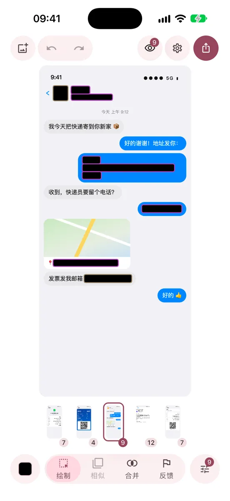
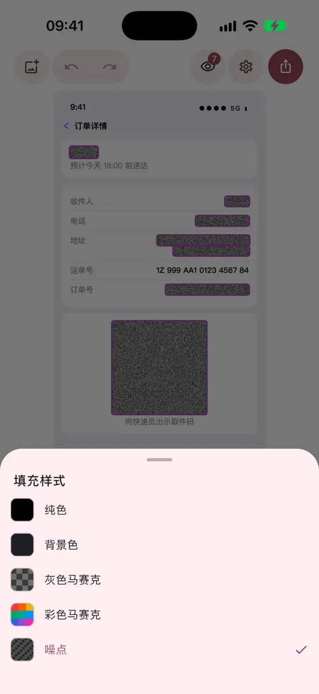
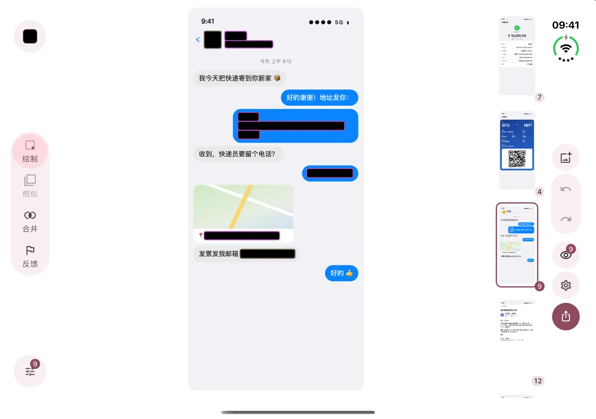

[English](README.md) | 简体中文

<div align="center">
  
  <h1>MosaicIt（码住）</h1>
  <p>全程离线的本地隐私打码工具——免 OCR、零网络代码、零相册读取权限，专为截图与照片设计。</p>
  <p>
    <a href="https://mosaic.lollipopkit.com">官网</a> ·
    <a href="https://github.com/lollipopkit/mosaic_it/releases">版本下载</a> ·
    <a href="https://mosaic.lollipopkit.com/feedback">检测反馈</a> ·
    <a href="LICENSE">AGPL-3.0</a>
  </p>
</div>

<p align="center">
  
  
  
</p>

## 简介

MosaicIt 在设备本地直接定位截图与照片中的敏感隐私区域——不执行 OCR 文字识别——并允许在导出前按需核对、增删和调整遮挡框。

应用内置 `unseen-det 0.6.0` 检测权重，不包含任何联网代码或网络权限，所有图片均不会离开你的设备。

## 下载安装

| 平台 | 发布产物 | 说明 |
| --- | --- | --- |
| Android（`arm64-v8a`） | `MosaicIt_vX.Y.Z_arm64.apk` | 正式签名 APK，内置 FP16 LiteRT 模型（`.tflite`），零 `android.permission.*` 权限 |
| macOS（Apple Silicon） | `MosaicIt_vX.Y.Z_NoSign_arm64.dmg` | 未签名 `arm64` 安装包，内置 FP16 ONNX 模型（`.onnx`），首次打开需在系统设置中允许 |
| iOS（`arm64`） | `MosaicIt_vX.Y.Z_NoSign.ipa` | 未签名 IPA，内置 FP16 ONNX 模型（`.onnx`），需自行签名安装 |
| Linux（`amd64`） | `MosaicIt_vX.Y.Z_linux_amd64.tar.gz` | 便携桌面应用包（`mosaicit`），内置 FP16 ONNX 模型（`.onnx`） |
| Windows（`amd64`） | `MosaicIt_vX.Y.Z_windows_amd64.zip` | 便携桌面应用包（`MosaicIt.exe`），内置 FP16 ONNX 模型（`.onnx`） |
| 命令行工具（`unseen`） | `unseen_vX.Y.Z_{linux_amd64,macos_arm64}.tar.gz`、`unseen_vX.Y.Z_windows_amd64.zip` | 预编译 Rust CLI（macOS 版本启用 CoreML） |

每个 GitHub Release 均附带 `BLAKE3SUMS` 与 `SHA256SUMS` 校验文件。请仅从 [GitHub Releases](https://github.com/lollipopkit/mosaic_it/releases) 下载安装包，或自行从源码构建。

## 核心功能

**免 OCR 本地检测**

- 内置 `unseen-det 0.6.0`（macOS / iOS / Linux / Windows 运行 FP16 ONNX，Android 运行 FP16 LiteRT），直接检测 UI 截图中的 **18 类隐私信息**，并配合 YuNet 检测 **人脸**（共 19 类）：
  `person_name`、`address`、`phone`、`email`、`id_number`、`bank_card`、`plate`、`account_id`、`avatar`、`qr`、`barcode`、`finance`、`organization`、`device_id`、`secret`、`person`、`health`、`personal_info`、`face`。
- 本地自适应偏好学习会根据你的勾选/取消记录微调预选阈值；也支持在设置中手动导入自定义 `.onnx` / `.tflite` 模型。

**5 种不可逆打码样式**

- 提供 **纯色（Solid）**、**环境融合（Surround）**、**灰度马赛克（Blocks）**、**彩色马赛克（Tinted）** 与 **噪点（Noise）**。
- 所有样式均不读取遮挡框内部的原始像素，防止反马赛克或去模糊还原。纯色、灰度马赛克与噪点完全不读取原图；环境融合与彩色马赛克仅采样框外 4 px 环带颜色。

**直达编辑器工作流**

- 启动即进入悬浮编辑界面，通过零权限系统选图器导入素材（iOS `PHPickerViewController`、Android 系统照片选择器、macOS / Linux / Windows 系统文件对话框）。
- 按住顶栏眼睛徽标可对比原图；支持点击切换遮挡、手动绘制、合并多行目标以及跨批量截图查找相似区域（Find similar）。
- 支持原生一键复制图像到剪贴板、系统分享面板、仅写入权限保存至相册，以及系统分享、打开方式和 macOS 窗口拖拽导入。
- **导出自检**：保存或分享前可对已打码图像重新运行检测器并检查像素相关性，提示可能遗漏的区域。

**独立 Rust 命令行工具（`unseen`）**

- 与客户端共用 `unseen-core`，支持脚本化批量检测/打码、性能基准测试、阈值校准与 BLAKE3 模型校验。

> 视频打码入口当前在应用内暂不开放，待支持原生视频输入输出模型后再启用。

## 隐私与安全边界

所有隐私承诺均在构建产物、系统权限清单与 CI 检查中强制校验：

| 检查项 | 实现方式 |
| --- | --- |
| 应用零网络代码 | 无 HTTP 客户端、统计 SDK 与崩溃上报；`ci.yml` 自动检查 `pubspec.yaml` 与 Dart 源码不含任何联网依赖或 Socket API。 |
| Android Release 零权限 | `release/AndroidManifest.xml` 剔除传递依赖引入的权限；`ci.yml` 与 `release.yml`（`aapt2 dump permissions`）强制验证最终 APK 不含任何 `android.permission.*`。 |
| 零相册读取权限 | iOS 仅使用系统进程外 `PHPickerViewController`（无 `NSPhotoLibraryUsageDescription`），保存仅申请 `.addOnly` 写入权限；Android 使用系统照片选择器。 |
| macOS 无网络沙盒 | `Release.entitlements` 仅启用 `app-sandbox` 与用户选定文件读写，不含任何 `com.apple.security.network.*` 权限（CI 自动校验）。 |
| 可选网页检测反馈 | 主动提交漏检/误检时，应用通过 URL `#fragment` 在系统浏览器中打开 [`mosaic.lollipopkit.com/feedback`](https://mosaic.lollipopkit.com/feedback)；fragment 不会进入 HTTP GET 日志，页面加载后立即经 `history.replaceState` 清除。 |

## 项目结构

```text
.
├── app/                      # Flutter 应用（iOS、macOS、Android、Linux、Windows）与 native-assets FFI hook
│   ├── lib/                  # Dart UI、编辑器、视频页、反馈交接与 FFI 绑定
│   ├── tool/                 # 模型打包脚本、Android 1Password 签名脚本、图标与多语言工具
│   └── packages/fl_lib/      # 共享 BoxApp UI 组件库（submodule）
├── crates/
│   ├── unseen-core/          # 检测解码、EXIF 方向校正、跟踪、不可逆像素覆写与 BLAKE3 清单
│   ├── unseen-infer/         # ONNX Runtime（CoreML/CUDA/CPU）与 LiteRT（GPU/CPU）推理后端
│   ├── unseen-media/         # 原生视频编解码（Apple AVFoundation、Android MediaCodec）
│   ├── unseen-ffi/           # flutter_rust_bridge FFI 接口层
│   └── unseen-cli/           # `unseen` 命令行工具
├── models/                   # 标准类别表（classes.json）与 BLAKE3 校验清单（manifest.toml）
├── website/                  # 官方网站（Svelte 5 + Vite，部署于 mosaic.lollipopkit.com）
└── worker/feedback/          # Cloudflare Worker（/feedback 与 /v1/feedback，R2 + 边缘限流）
```

## 从源码构建

```sh
git clone --recurse-submodules https://github.com/lollipopkit/mosaic_it
cd mosaic_it
```

### Rust CLI 与工作区测试

```sh
cargo test --workspace
cargo build --release -p unseen-cli                     # target/release/unseen
cargo build --release -p unseen-cli --features coreml   # macOS CoreML / ANE 加速
```

### Flutter 应用

macOS、iOS、Android 与 Linux 构建会通过 `app/tool/bundle-model.sh` 自动准备并按 BLAKE3 校验 `models/manifest.toml` 中锁定的 `0.6.0` 权重（优先使用 `UNSEEN_MODEL_DIR`，否则自动下载并缓存）；Windows 本地构建后请在 Git Bash 中执行 `tool/bundle-model.sh tiled build/windows/x64/runner/Release/models`。

```sh
cd app
flutter pub get
flutter analyze
flutter test

# 按平台运行或构建
flutter run -d macos                                          # macOS（Apple Silicon）
flutter build macos --release
flutter build ios --release --no-codesign                     # iOS（arm64）
flutter build apk --release --target-platform android-arm64   # Android（arm64-v8a）
flutter build linux --release                                 # Linux（amd64）
flutter build windows --release                               # Windows（amd64）
```

通过 1Password（`MosaicIt CI/unseen-android-keystore`）执行 Android 正式签名构建：

```sh
cd app && tool/android-signing.sh flutter build apk --release --target-platform android-arm64
```

### 官网与反馈 Worker

```sh
cd website && npm ci && npm run check && npm run build
cd worker/feedback && npm test
```

## 文档

- [app/README.md](app/README.md) — Flutter 客户端配置与平台说明

## 贡献与开源协议

- 代码与权重均基于 [AGPL-3.0](LICENSE) 协议开源。
- 提交贡献需签署 [CLA](CLA.md)（[中文版](CLA_zh.md)），详见 [CONTRIBUTING.md](CONTRIBUTING.md)。
